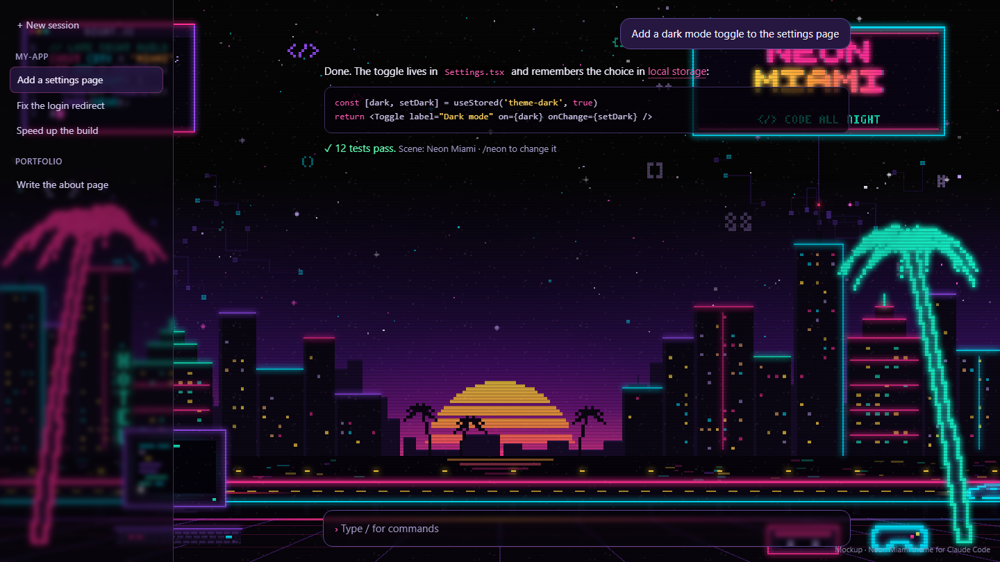
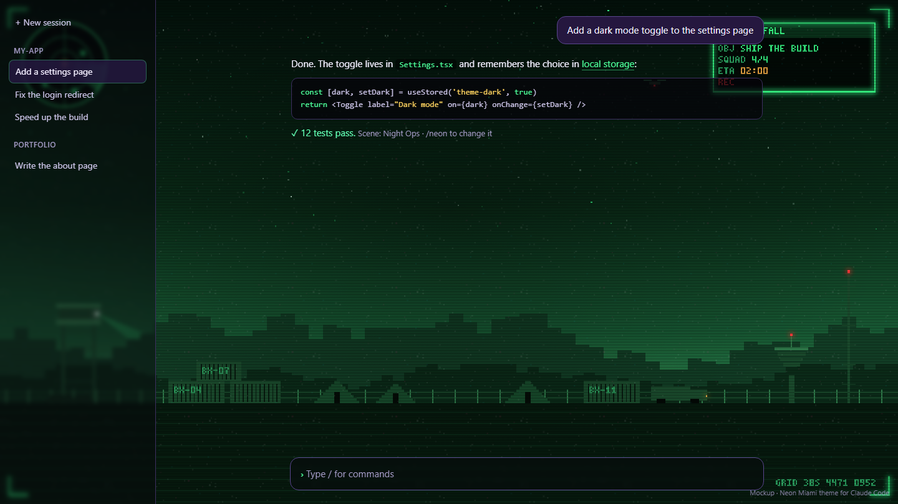
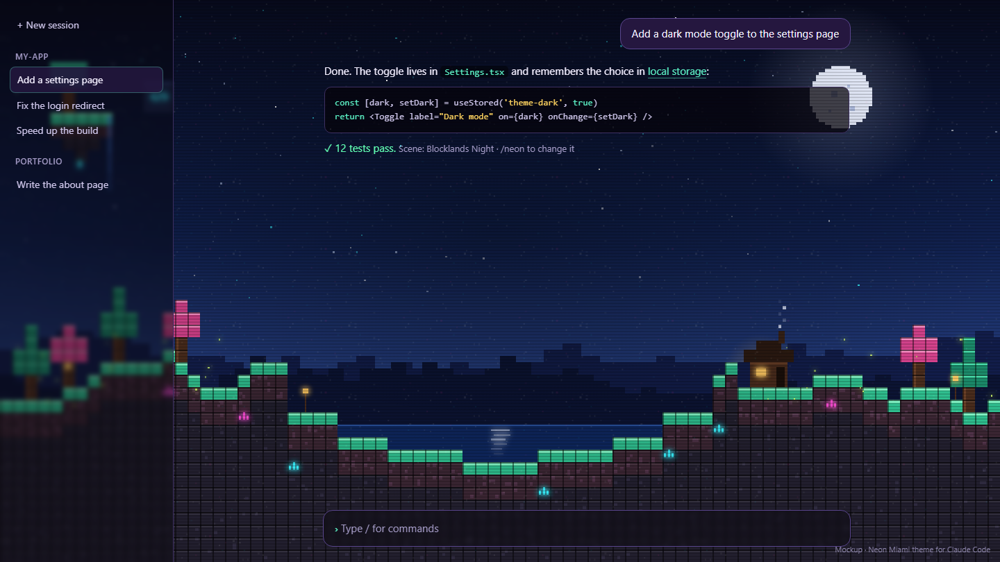

# Neon Miami for Claude Code

Animated pixel-art scenes behind your Claude Code chat, with neon text colors and a neon skyline
in the terminal. Fireworks go off when Claude finishes a long task, and a red alert flashes when
tests fail.


**[▶ Watch the full demo video (28 s)](screenshots/demo.mp4)**

## Install

**Windows** (PowerShell):

```powershell
irm https://raw.githubusercontent.com/gaurangg123/claudechatmod/main/install.ps1 | iex
```

**macOS / Linux**:

```bash
curl -fsSL https://raw.githubusercontent.com/gaurangg123/claudechatmod/main/install.sh | bash
```

Then start a new Claude Code session. That's it.

You need [Claude Code](https://claude.com/claude-code) and `git`.

## Use

A new scene appears every minute. Type `/neon` in Claude Code to change things:

| Command | What it does |
| --- | --- |
| `/neon next` | Show the next scene |
| `/neon scene neon-rain` | Pick a scene |
| `/neon slideshow off` | Keep the current scene |
| `/neon motion off` | Stop the animation |
| `/neon party` | Show the fireworks now |
| `/neon reactions off` | No fireworks or test alerts |

## Scenes

| | |
| --- | --- |
|  **Neon Miami** |  **Neon Rain** |
|  **Blocklands Day** |  **Night Ops** |
|  **Blocklands Night** | |

All scenes are original art. The pictures and the demo are mockups of the desktop app, made from
the theme's own scenes.

## Uninstall

```bash
claude plugin uninstall neon-miami@claudechatmod
```

Then pick another theme with `/theme`.

<details>
<summary>More options</summary>

**Install by hand.** In a Claude Code terminal session:
`/plugin install neon-miami --marketplace gaurangg123/claudechatmod`

**Cloud sessions.** Add this to the project's `.claude/settings.json`:

```json
{
  "extraKnownMarketplaces": {
    "claudechatmod": { "source": { "source": "github", "repo": "gaurangg123/claudechatmod" } }
  },
  "enabledPlugins": { "neon-miami@claudechatmod": true }
}
```

**Change the art.** See [dev/README.md](dev/README.md).

</details>

## License

GPL-3.0
